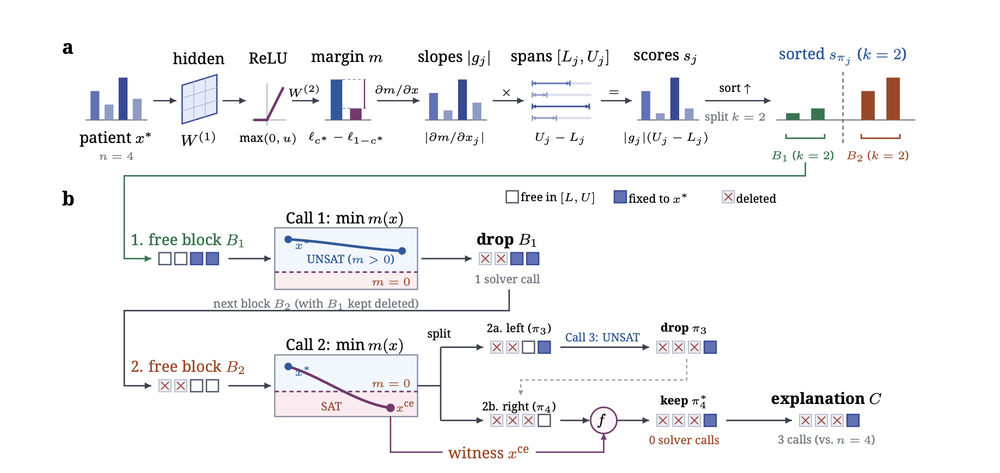

# Faster Formal Explanations by Guided Deletion

### Explainable AI (DS5622) Course Project

**Authors:** Vidya M. and Ben George

---

## 1. Project Overview

An abductive explanation (or prime implicant) for a classifier prediction is a minimal subset of input feature values that guarantees the same prediction across the entire input domain.

Ignatiev et al. (AAAI 2019) proposed algorithms for computing abductive explanations using a Mixed-Integer Linear Programming (MILP) solver.

Algorithm 1 tests features for removal one at a time in a fixed order. However, the size of the resulting explanation depends on the order in which features are tested.

Algorithm 2 searches for an explanation of minimum cardinality using an implicit hitting-set formulation, but requires substantially more solver calls.

This project investigates two modifications to Algorithm 1 for ReLU neural networks to improve explanation quality and computational efficiency.

## 2. Proposed Methodology

*Figure 1: Overview of the guided deletion methodology.*

We investigate two modifications:

### A. Gradient-Guided Feature Ordering

Candidate features are ordered using the range-scaled input gradient of the class margin.

Features with lower estimated sensitivity are tested for removal first.

### B. Group Deletion with Recursive Splitting

Features are tested in contiguous groups.

If a group cannot be removed together, it is recursively split into smaller groups.

Counterexamples obtained from previous solver calls are reused to reduce unnecessary MILP computations.

## 3. Experimental Setup

The experiments were conducted using two UCI datasets:

- Breast Cancer: 9 input features
- Heart Statlog: 13 input features

The evaluation uses 120 held-out test instances over three random seeds, as reported in the project.

The proposed method uses group size k = 4.

## 4. Results

### Explanation Size

| Dataset | Algorithm 1 | Proposed Method (k=4) |
|---|---|---|
| Breast Cancer | 5.77 ± 1.25 | 5.48 ± 1.37 |
| Heart Statlog | 7.50 ± 1.16 | 6.93 ± 1.22 |

Values represent mean explanation size ± standard deviation.

### Computational Efficiency

- Reduction in MILP solver calls: 44.6%–46.8% compared with Algorithm 1.
- Execution time: approximately 9 times faster than Algorithm 2.

The experimental results suggest that gradient-guided group deletion can improve explanation compactness while substantially reducing computational cost.

## 5. Implementation

The implementation and experiments are available in the Jupyter notebook:

[XAI_course_project.ipynb](XAI_course_project.ipynb)

## 6. How to Run

1. Download or clone this repository.
2. Open `XAI_course_project.ipynb` in Jupyter Notebook or Google Colab.
3. Install the dependencies used in the notebook.
4. Execute the notebook cells in order.
5. Inspect the generated experimental results.

## 7. Reference

Ignatiev et al. (AAAI 2019), work on computing abductive explanations using MILP.

The full bibliographic reference and figure attribution should be added from the original source.

